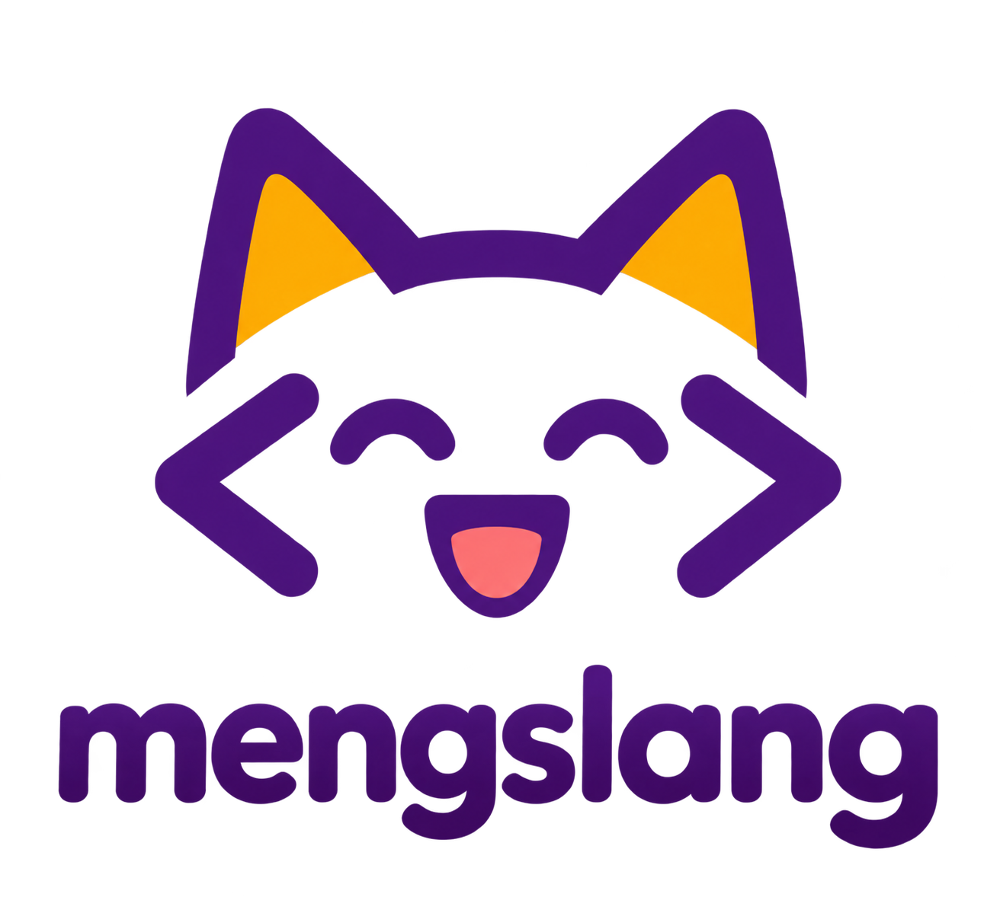

<p align="center">
  
</p>

# Meng Language

A small, statically typed programming language with compile-time ownership checks.
Run programs with the built-in interpreter or compile them to native binaries through C.

The name comes from **meng** — an Indonesian nickname for a cat, inspired by its meow.

## Install

Requires Rust with support for the 2024 edition. GCC is needed to compile and run native binaries.

```bash
curl -sSf https://raw.githubusercontent.com/simenglabs/mengs-lang/main/install.sh | sh
```

To also install the VS Code extension, append `-s -- --vscode` after `sh`.
From a local checkout, use `./install.sh`.
Open a new terminal if the installer updates your PATH.

## Get started

```bash
meng interpret test/main.meng
```

The CLI also supports `check`, `compile`, `run`, and `emit` (prints the generated C).
Language syntax and usage guides will live in the documentation.

## Development

Run `cargo test` to check the compiler and interpreter.

- [VS Code extension](editors/vscode/README.md)
- [Roadmap](TODO.md)
